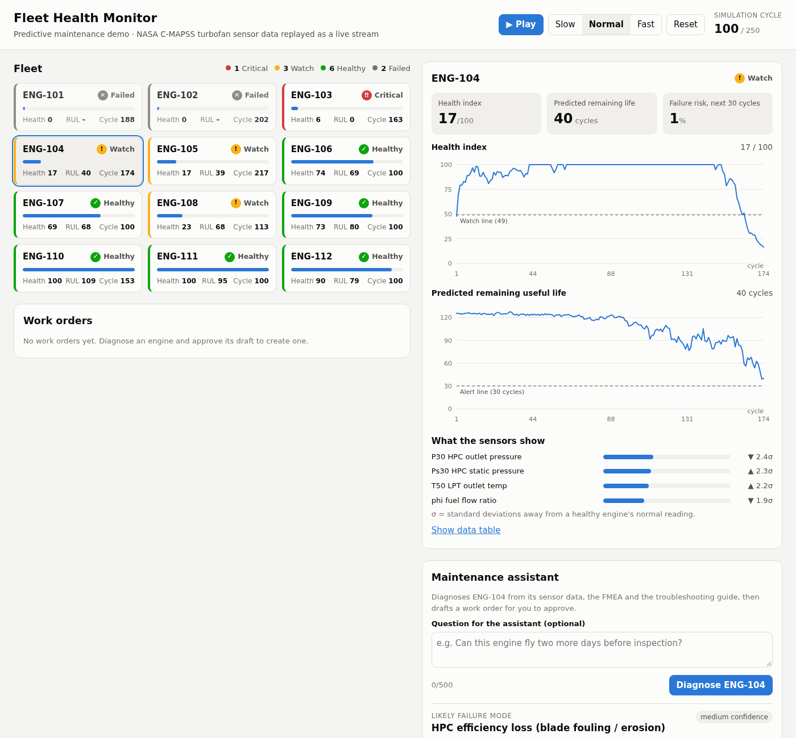
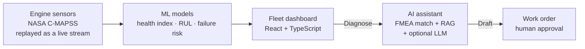
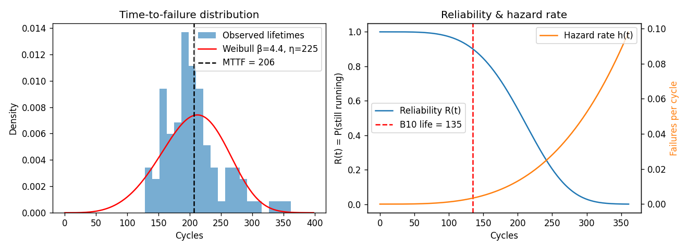
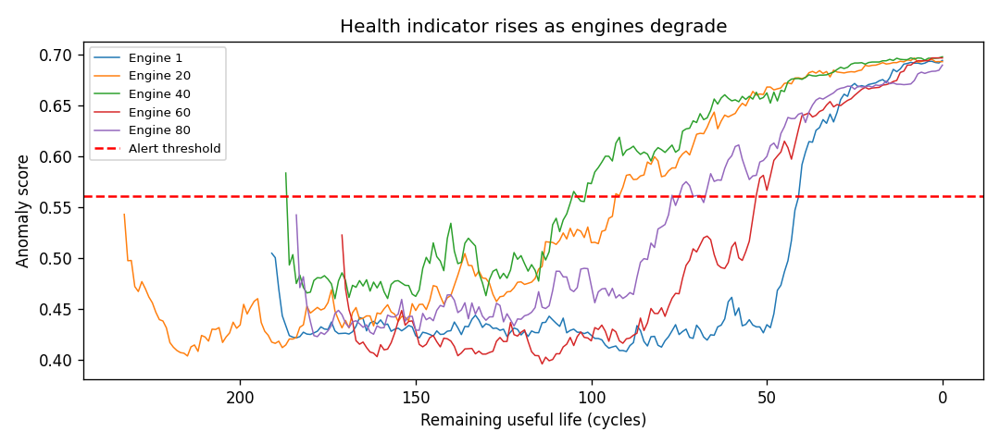

# Predictive Maintenance: Fleet Health Monitor with an AI Maintenance Assistant

An end-to-end **industrial AI** demo. Machine learning watches a fleet of turbofan engines, detects degradation early, predicts remaining useful life, and an **AI maintenance assistant** (FMEA + retrieval-augmented generation) explains each alert and drafts a work order for a planner to approve.



**Stack:** Python · scikit-learn · FastAPI · React + TypeScript · Claude / Ollama (optional) · Docker · GitHub Actions
**Security:** built and tested against the OWASP Top 10 and the OWASP Top 10 for LLM Applications. See [SECURITY.md](SECURITY.md).

---

## What it does



1. **Monitor:** 12 engines that the models never saw in training are replayed cycle by cycle. Each shows a health index, predicted remaining useful life (RUL), and failure risk in the next 30 cycles.
2. **Detect:** status moves from Healthy → Watch → Alert → Critical as the engine degrades. In the demo fleet the first warning comes **26–149 cycles before failure (median 54)**.
3. **Diagnose:** the assistant matches the sensor pattern to failure modes in an **FMEA**, retrieves the matching troubleshooting procedures (RAG), and writes a diagnosis with evidence, actions and sources. It runs fully offline by default and can optionally use **Claude** or a **local Ollama model** for the write-up.
4. **Act:** a draft work order is created with priority and due date set by fixed rules. A person approves it.

## Model results (FD001 test set, 100 engines)

| Area | Method | Result |
|---|---|---|
| Reliability | Weibull fit on 100 run-to-failure lifetimes | **β = 4.4** (wear-out), **MTTF = 206 cycles**, **B10 life = 135 cycles** |
| Early degradation detection | Isolation Forest trained on healthy data only | **100%** of engines flagged before failure, **median lead time 50 cycles** |
| Remaining Useful Life | Gradient Boosting regression on rolling time-series features | **RMSE 17.5 cycles**, MAE 12.7 |
| Failure within 30 cycles | Gradient Boosting classification | **ROC-AUC 0.98**, precision 0.90, recall 0.76 |
| Maintenance policy | Maintain when predicted RUL ≤ 30, vs run-to-failure | **~61% lower maintenance cost** (illustrative 10:1 cost ratio) |

Validation uses **GroupKFold by engine**, so no engine appears in both training and validation. The full analysis is in [`ml/predictive_maintenance.ipynb`](ml/predictive_maintenance.ipynb) and the metrics in [`ml/reports/metrics.json`](ml/reports/metrics.json).

| Reliability (Weibull) | Early warning (health index) |
|---|---|
|  |  |

**Reliability reasoning (RCM):** β > 1 means wear-out failure, and the health indicator gives about 50 cycles of warning (the P-F interval). Under RCM decision logic, that makes **condition-based / predictive maintenance** the right strategy. Fixed-interval replacement at the B10 life would waste about a third of each engine's useful life.

## Run it

### Option 1: Docker (one command)

```bash
docker compose up --build
# open http://localhost:8095   (change the port with WEB_PORT=xxxx)
```

### Option 2: Local development

```bash
# Backend
cd backend
python -m venv .venv && source .venv/bin/activate
pip install -r requirements-dev.txt
APP_ENV=development uvicorn app.main:app --reload --no-server-header   # http://localhost:8000/api/docs

# Frontend (second terminal)
cd frontend
npm ci
npm run dev                                                              # http://localhost:5173
```

### Turning on the LLM (optional)

The assistant works without any API key. To have an LLM write the diagnosis:

```bash
# Claude
export LLM_PROVIDER=anthropic ANTHROPIC_API_KEY=sk-ant-...
# or a free local model with Ollama
export LLM_PROVIDER=ollama OLLAMA_MODEL=llama3.1
```

If the model is unavailable, refuses, or returns invalid output, the app falls back to the offline rules and says so on screen.

### Re-training the models

```bash
cd ml
pip install -r requirements.txt
mkdir -p data/raw && cd data/raw
curl -L -o cmapss.zip "https://phm-datasets.s3.amazonaws.com/NASA/6.+Turbofan+Engine+Degradation+Simulation+Data+Set.zip"
unzip cmapss.zip && unzip "6. Turbofan Engine Degradation Simulation Data Set/CMAPSSData.zip" -d cmapss
cd ../..
python pdm_pipeline.py      # analysis, figures and metrics
python export_fleet.py      # writes backend/app/data/fleet.json for the app
```

### Tests and security checks

```bash
cd backend && pytest && bandit -q -r app && pip-audit -r requirements.txt
cd frontend && npm run build && npm audit
```

CI runs all of these plus CodeQL on every push ([`.github/workflows/ci.yml`](.github/workflows/ci.yml)).

## Project structure

```
ml/          model training and analysis (notebook, export of the demo fleet)
backend/     FastAPI service: fleet replay, AI assistant, work orders, security middleware
  app/knowledge/   FMEA records and troubleshooting procedures searched by the assistant
  tests/           API, security-control and AI-guardrail tests
frontend/    React + TypeScript dashboard, nginx config with strict CSP
.github/     CI (tests, Bandit, pip-audit, npm audit, CodeQL) and Dependabot
```

## FMEA used by the assistant (illustrative)

FD001 has one fault mode: **High-Pressure Compressor (HPC) degradation**. The assistant scores each FMEA failure mode by how well the engine's sensor deviations match the mode's signature.

| Failure mode | Signature (sensor direction) | S | O | D | RPN |
|---|---|---|---|---|---|
| HPC efficiency loss | T30 ↑, T50 ↑, Ps30 ↑, phi ↓ | 7 | 6 | 3 | 126 |
| HPC flow capacity loss | P30 ↓, Ps30 ↑, phi ↓, Nc ↑ | 9 | 4 | 4 | 144 |
| HPT blade thermal wear | T50 ↑, T30 ↑, Nc ↑ | 9 | 3 | 5 | 135 |
| Fan blade damage | BPR ↑ | 8 | 3 | 5 | 120 |
| Sensor drift | one sensor far off, others normal | 5 | 4 | 6 | 120 |

The FMEA and procedures were written for this demo from the C-MAPSS sensor documentation. They are not OEM maintenance data.

## Next steps

- Stream live data over **MQTT / OPC UA** from an IIoT gateway instead of replaying files.
- Replace BM25 retrieval with a **vector store** (FAISS, Milvus, pgvector) over real manuals and work-order history.
- Write approved work orders to an **EAM/CMMS** (e.g. IBM Maximo, SAP PM) through its API.
- Add **SSO** (OIDC) and role-based approval (see [SECURITY.md](SECURITY.md)).
- Extend to FD002–FD004 (multiple operating conditions and fault modes).

## Data citation

A. Saxena and K. Goebel (2008). "Turbofan Engine Degradation Simulation Data Set", NASA Ames Prognostics Data Repository, NASA Ames Research Center, Moffett Field, CA.
